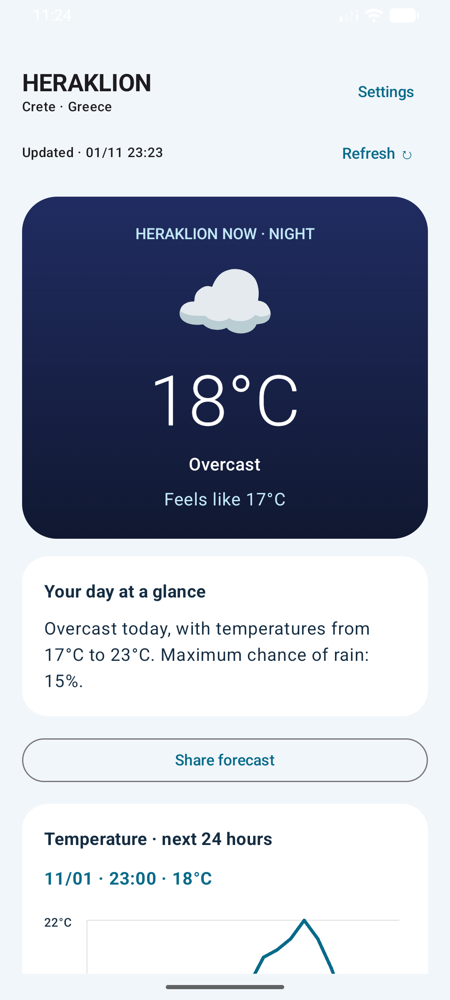
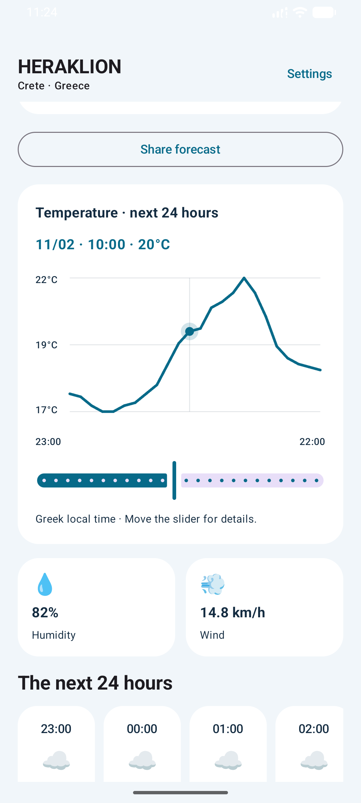
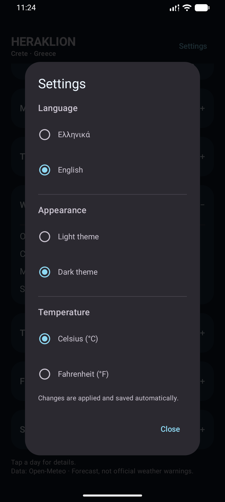
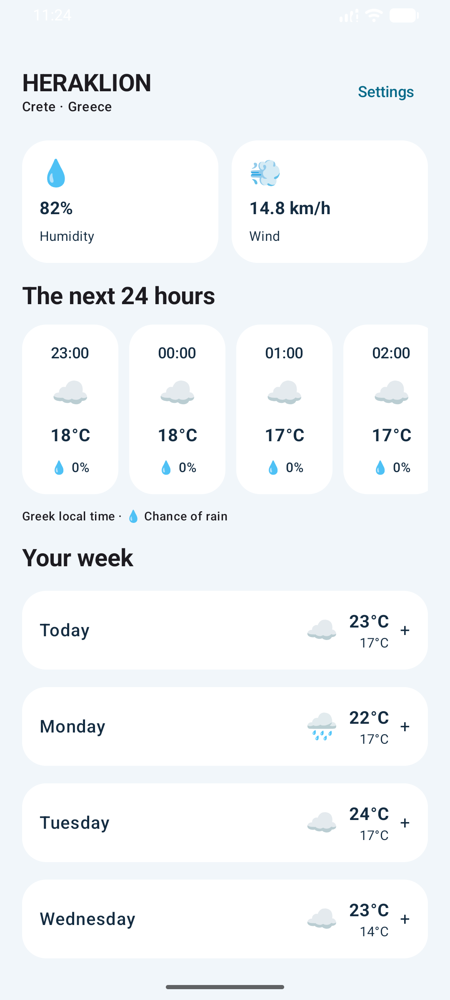
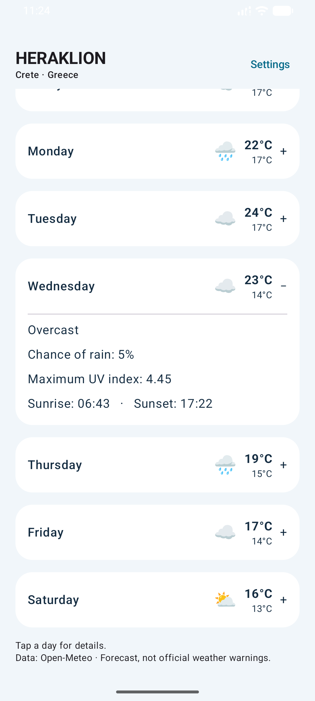
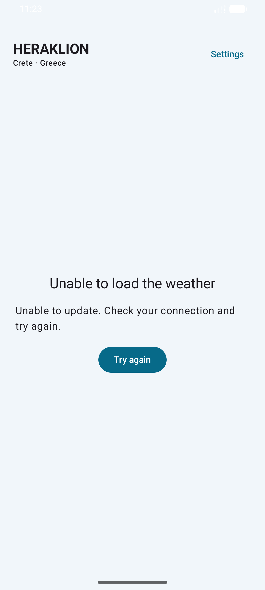

# Heraklion Weather App ☀️🌧️
<p align="center">
  
  
  
</p>

<p align="center">
  
  
  
</p>

A modern and elegant Android application that displays real-time weather data for **Heraklion, Crete**. Built from scratch using the latest Android development technologies and best practices (Jetpack Compose, MVVM).

## 🌟 Features
* Displays current temperature and "feels like" temperature.
* Displays additional metrics: **Humidity** and **Wind Speed**.
* **7-day** weather forecast (minimum and maximum temperatures).
* Visual representation of weather conditions using Emojis (e.g., ☀️, 🌧️, ⛅).
* Modern, clean, and user-friendly UI with soft colors.
* Robust error handling (e.g., no internet connection) with a "Try Again" option.

## 🛠️ Tech Stack
* **Programming Language:** [Kotlin](https://kotlinlang.org/) (100%)
* **User Interface:** [Jetpack Compose](https://developer.android.com/jetpack/compose) (Material 3)
* **Architecture:** MVVM (Model-View-ViewModel)
* **Asynchronous Programming:** Coroutines & StateFlow
* **Networking:** [Retrofit](https://square.github.io/retrofit/) & OkHttp
* **JSON Parsing:** [Kotlinx Serialization](https://github.com/Kotlin/kotlinx.serialization)

## 📡 Data & API
The app fetches its data via the free [Open-Meteo API](https://open-meteo.com/), which does not require an API Key. The coordinates are configured for the center of Heraklion (Latitude: 35.3387, Longitude: 25.1442).

## 🚀 Local Installation
1. Clone the repository:
   ```bash
   git clone https://github.com/KonstantinosChr/Heraklion-Weather-Project.git
Open the project in Android Studio or IntelliJ IDEA.
Allow Gradle to finish the synchronization (Sync).
Press the Run button, selecting an Emulator or a physical Android device (API 24+).
Crafted with passion as my first Android Project!
