<p align="center">
  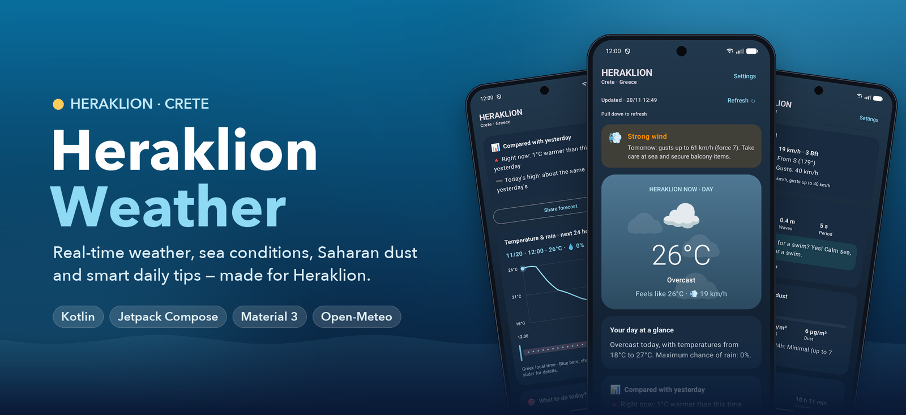
</p>

<p align="center">
  
  
  
  
</p>

A modern and elegant Android application that displays real-time weather data for **Heraklion, Crete**. Beyond the forecast, it shows sea conditions, wind and meltemi, Saharan dust and air quality, weather alerts and simple tips for the day. Built from scratch with Jetpack Compose and MVVM.

## ✨ Highlights

<p align="center">
  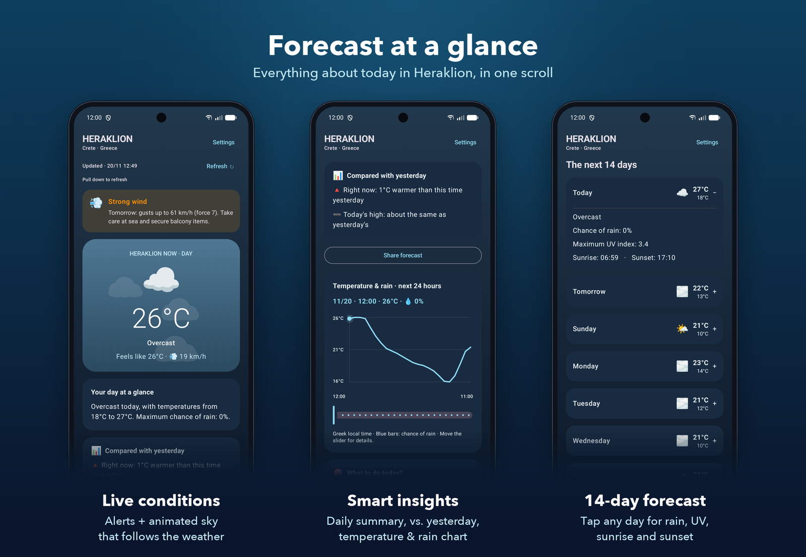
</p>

<p align="center">
  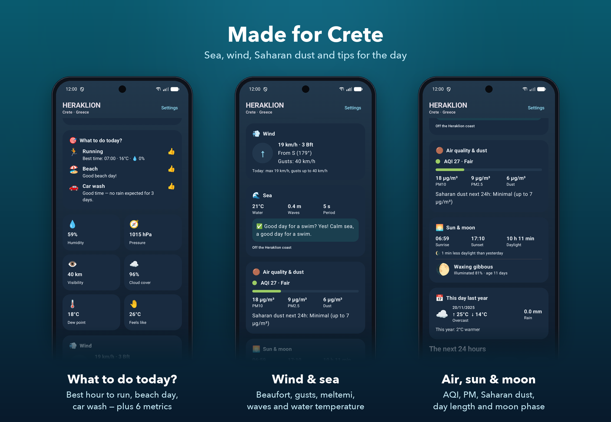
</p>

<p align="center">
  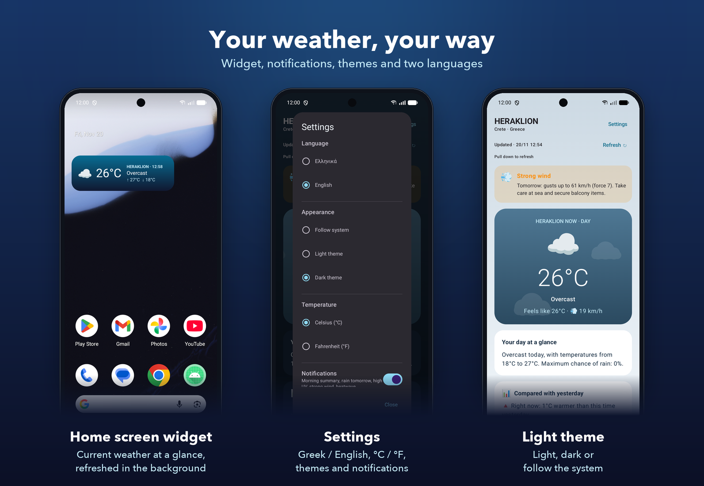
</p>

## 📱 Screenshots

| Overview | Insights | What to do today? |
|:---:|:---:|:---:|
| 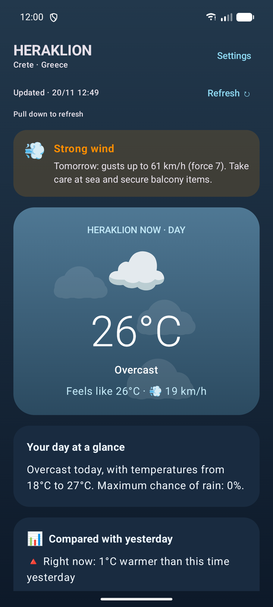 | 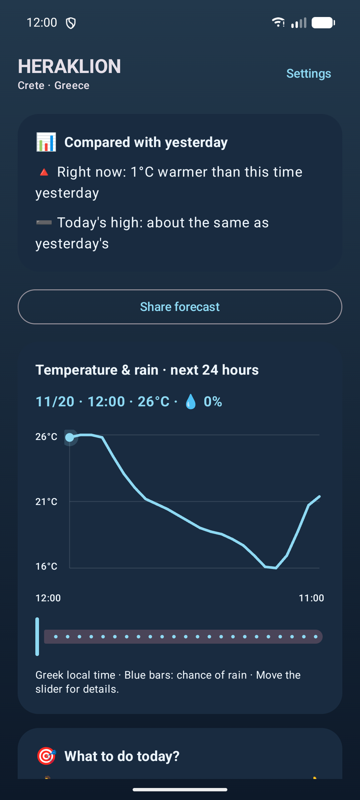 | 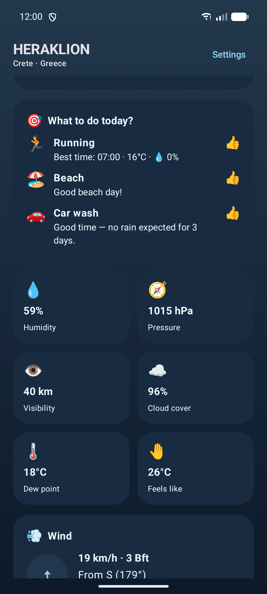 |
| **Wind & sea** | **Air, sun & moon** | **14-day forecast** |
| 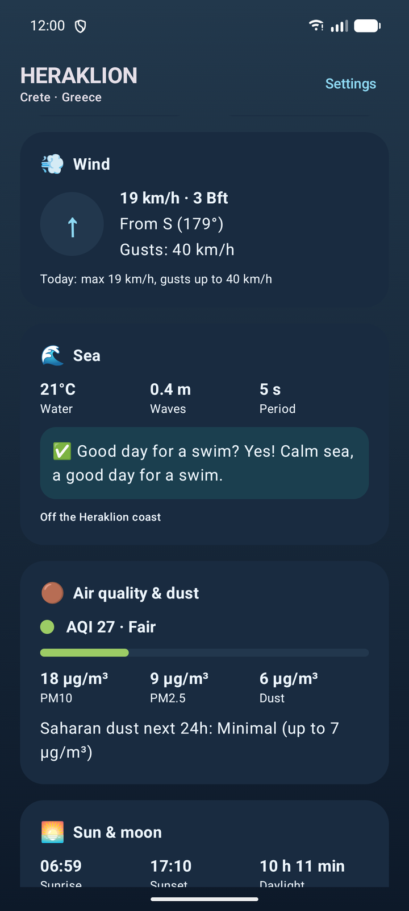 | 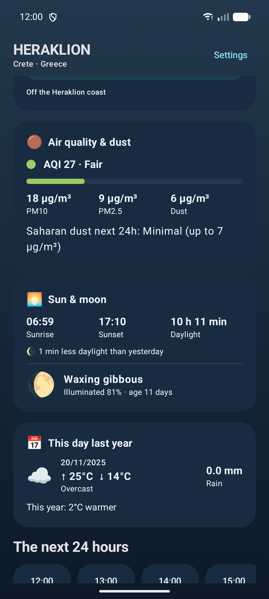 | 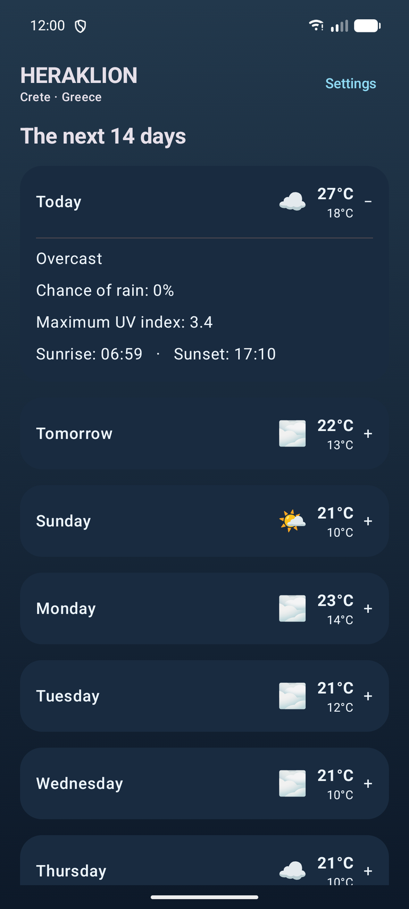 |
| **Home screen widget** | **Settings** | **Light theme** |
| 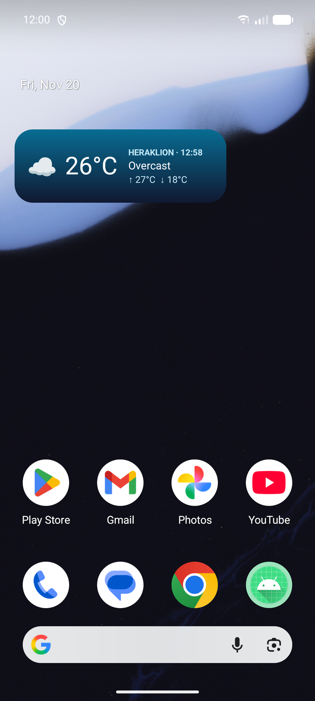 | 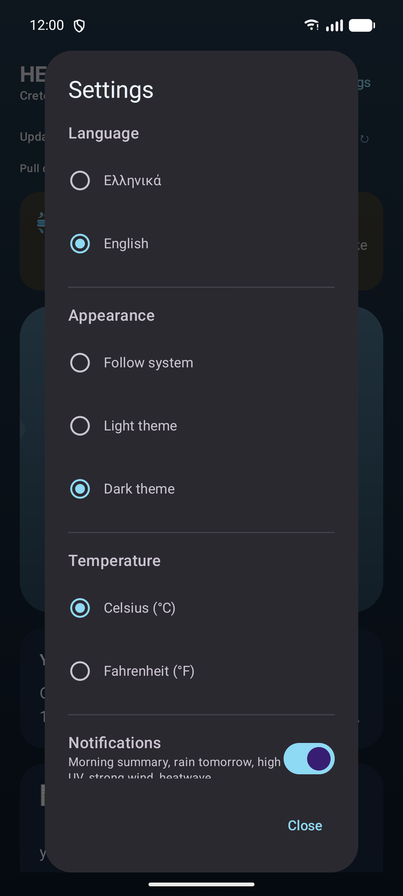 | 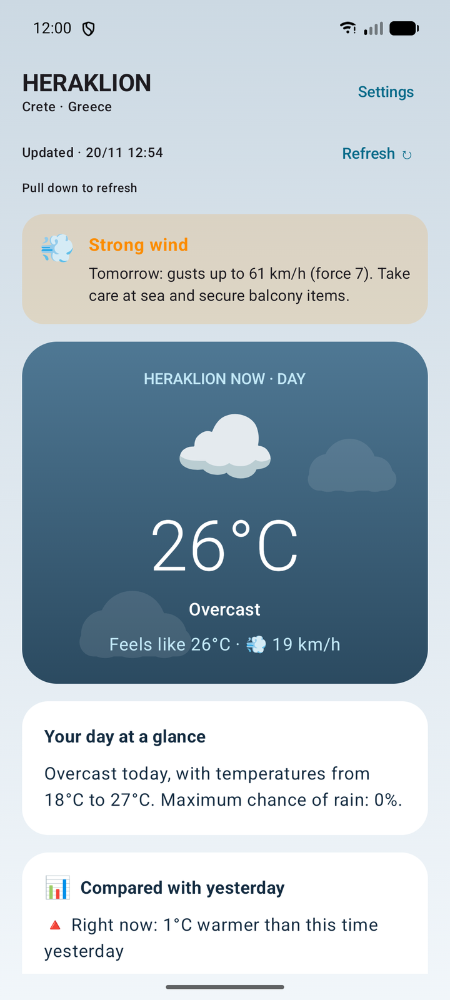 |
| **Ελληνικά** | **Offline / error state** | |
| 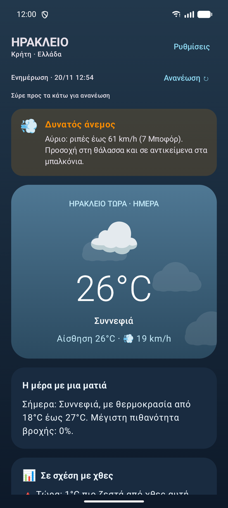 | 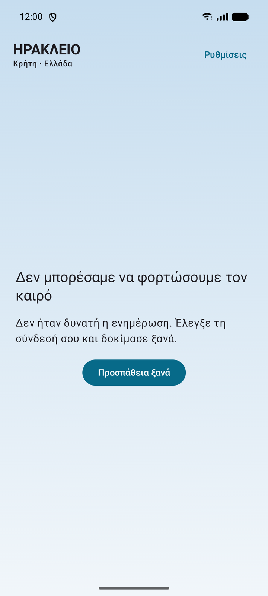 | |

## 🌟 Features
### Forecast
* Current temperature, "feels like", humidity, wind, **pressure, visibility, cloud cover and dew point**.
* Hourly forecast for the next 24 hours and a **14-day** forecast with expandable day details.
* Interactive temperature chart with **hourly chance of rain** bars.
* Daily summary card and **comparison with yesterday** (now vs. the same hour yesterday, today's high vs. yesterday's).
* **This day last year** – historical weather for today's date one year ago.

### Heraklion & Crete
* **Sea conditions** – water temperature, wave height and period, plus a "good day for a swim?" verdict.
* **Wind in detail** – direction arrow, compass point, Beaufort scale, gusts and a **meltemi** indicator.
* **Air quality & Saharan dust** – European AQI, PM10, PM2.5 and the dust peak for the next 24 hours.
* **Weather alerts** for heatwaves, strong wind, meltemi, Saharan dust and very high UV.
* **Activity suggestions** – best hour for running, beach day check and whether to wash the car.
* **Sun & moon** – sunrise, sunset, day length (and change from yesterday), moon phase and illumination.

### App
* **Home screen widget** with the current weather and today's range.
* **Notifications** (opt-in): morning summary, rain tomorrow, high UV, strong wind and heatwave – each at most once per day.
* Background refresh with WorkManager (only while the widget or notifications are in use).
* **Pull-to-refresh** and automatic refresh when data is older than 30 minutes.
* **Dynamic sky** – animated rain, snow, storm flashes, stars, sun rays or drifting clouds, and a background tinted by the weather.
* Offline cache, share the forecast as an image.
* Settings: Greek/English, light/dark/system theme, °C/°F, notifications.
* Robust error handling with a "Try Again" option.

## 🛠️ Tech Stack
* **Programming Language:** [Kotlin](https://kotlinlang.org/) (100%)
* **User Interface:** [Jetpack Compose](https://developer.android.com/jetpack/compose) (Material 3)
* **Architecture:** MVVM (Model-View-ViewModel)
* **Asynchronous Programming:** Coroutines & StateFlow
* **Networking:** [Retrofit](https://square.github.io/retrofit/) & OkHttp
* **JSON Parsing:** [Kotlinx Serialization](https://github.com/Kotlin/kotlinx.serialization)
* **Background work:** [WorkManager](https://developer.android.com/topic/libraries/architecture/workmanager)
* **Widget:** AppWidgetProvider with RemoteViews
* **Tests:** JUnit unit tests for the forecast insights (alerts, wind, sea, moon, comparisons, activities)

## 📡 Data & API
The app fetches its data via the free [Open-Meteo](https://open-meteo.com/) APIs (Forecast, Marine, Air Quality and Historical), which do not require an API Key. The coordinates are configured for the center of Heraklion (Latitude: 35.3387, Longitude: 25.1442).

## 🚀 Local Installation
1. Clone the repository:
   ```bash
   git clone https://github.com/KonstantinosChr/Heraklion-Weather-Project.git
   ```
2. Open the project in Android Studio or IntelliJ IDEA.
3. Allow Gradle to finish the synchronization (Sync).
4. Press the **Run** button, selecting an Emulator or a physical Android device (API 24+).

To run the unit tests:
```bash
./gradlew :app:testDebugUnitTest
```

---

<p align="center">Crafted with passion as my first Android project! 🇬🇷</p>
